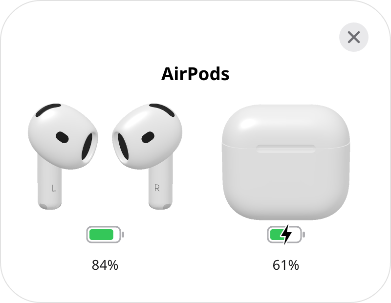
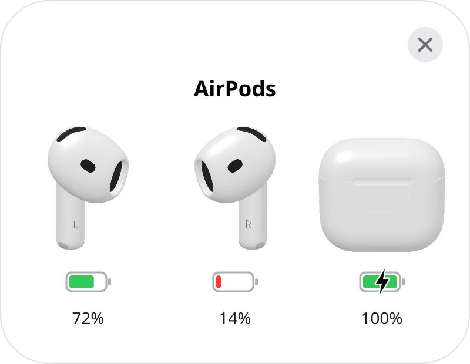
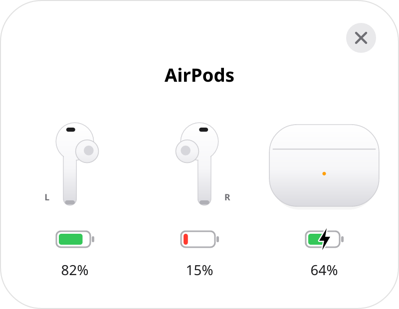
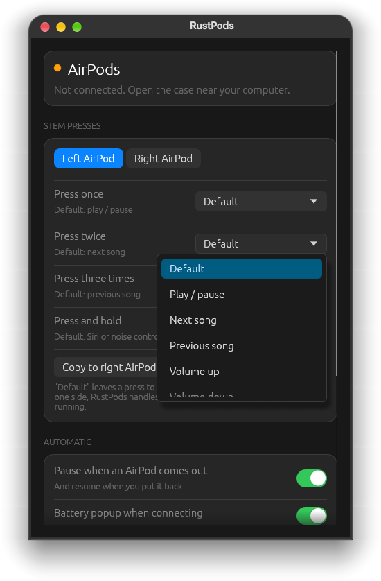

<div align="center">


# rustpods

**AirPods, but they feel at home on Linux.**

The battery popup you know from your phone, ear detection that pauses your music, stem presses that
skip songs, noise control, and battery levels right in your desktop. One small Rust binary, no root.

[](LICENSE)




</div>

---

## Why

Out of the box, Linux treats AirPods like any other Bluetooth headset. You get sound, and that's it.
No battery levels, no ear detection, no noise control, and stem presses that may or may not reach your
music player. AirPods do support all of this. They just speak a private protocol (AAP) that Linux
doesn't know.

rustpods speaks it.

## Features

| | |
| --- | --- |
| 🔋 **Battery popup** | Slides up when your AirPods connect: left, right and case, with charging state. Click to dismiss. |
| 📲 **Connection assistant** | Open the case near your computer and a popup offers to connect, with the battery levels from the case. One click and you're listening. |
| 🖥️ **Battery in your desktop** | Shows up in KDE, GNOME, UPower and every battery widget, like any other Bluetooth device. |
| 👂 **Ear detection** | Take an AirPod out and the music pauses. Put it back and it resumes. |
| 👆 **Stem presses** | Press once to play/pause, twice for the next song, three times for the previous one, in whatever is playing. |
| 🎛️ **Your own shortcuts, per side** | Give the left and right AirPod different actions for one, two or three presses and press-and-hold: volume, noise mode, mute, the popup, or any command. |
| 🎧 **Noise control** | Off, noise cancellation, transparency and adaptive, plus conversational awareness. |
| 🗣️ **Volume ducking** | Lowers the music while you talk (`--duck`, on models with conversational awareness). |
| 🪫 **Low battery alerts** | A notification at 20 % and at 10 %. |
| 🎚️ **Audio profiles** | One command out of the muffled phone-call mode back to full-quality AAC, or into mic mode for calls. |
| 🩺 **Doctor** | `rustpods doctor` checks your Bluetooth and audio setup and tells you exactly what to change. |
| 📊 **Waybar module** | Battery and noise mode in your bar; click to switch modes. |

<p align="center">
  
  &nbsp;
  
</p>
<p align="center"><sub>When the buds differ, they get their own entry; low levels turn red.
Right: the built-in drawings used when no product pictures are installed.</sub></p>

## Install

**Download one file from the [latest release](https://github.com/Waysel07/rustpods/releases/latest), open it, done.** No terminal needed.

| Your system | Download |
| --- | --- |
| Ubuntu, Linux Mint, Pop!_OS, Debian, Zorin | `rustpods_…_amd64.deb`: double-click to install |
| Fedora, openSUSE, Nobara | `rustpods-….x86_64.rpm`: double-click to install |
| Anything else (Arch, CachyOS, Manjaro, Steam Deck, …) | `RustPods-…-x86_64.AppImage`: right-click → Properties → *Allow executing*, then double-click |

Then open **RustPods** from your app menu. The first time, it starts the background service and turns
on *Start at login*. Pair your AirPods the usual way (system settings) and you're set.

<details>
<summary><b>Arch package, or building from source</b></summary>

Arch-based distros can build a native package from [`packaging/arch/PKGBUILD`](packaging/arch/PKGBUILD)
with `makepkg -si`.

From source (needs Rust):

```sh
git clone https://github.com/Waysel07/rustpods
cd rustpods
cargo build --release
install -Dm755 target/release/rustpods ~/.local/bin/rustpods
rustpods            # opens the app and sets up the background service
```

`rustpods install` sets the service up through systemd instead, if you prefer that.

</details>

## Settings



Open **RustPods** from your app menu (or run `rustpods`).

- **Stem presses:** pick an action for each press, separately for the left and the right AirPod.
  Choices: play/pause, next, previous, volume up/down, mute, next noise mode, conversation awareness,
  battery popup, nothing, or *Run command…* for anything else (`playerctl`, `notify-send`, a script).
- **Noise control** and **conversation awareness**, when your AirPods have them.
- **Automatic:** auto-pause, popup on connect, connection assistant, low battery alerts, desktop battery, volume ducking.

Changes apply immediately and are stored in `~/.config/rustpods/config.json`.

> Per-side presses work on AirPods with a press sensor (AirPods 3, 4, Pro, Pro 2/3). Presses left on
> *Default* stay with the AirPods, so nothing changes until you pick something.

<br clear="right">

## Usage

```console
$ rustpods status
AirPods  (AirPods 4, 12:34:56:78:9A:BC)
  Left     █████████░  86%
  Right    ████████░░  84%
  Case     ██████░░░░  61%  charging
  Ears     primary in ear, secondary in ear
```

| Command | What it does |
| --- | --- |
| `rustpods status [--json]` | Battery, ears, noise mode |
| `rustpods noise <mode>` | `off`, `anc`, `transparency`, `adaptive`, or `next` to cycle |
| `rustpods conversation on\|off` | Conversational awareness |
| `rustpods profile [music\|call]` | Best A2DP codec, or headset mode with the mic; no argument lists profiles |
| `rustpods` / `rustpods settings` | Open the app |
| `rustpods popup [--demo]` | Show the popup now |
| `rustpods list` | Paired AirPods and Beats |
| `rustpods doctor` | Check the setup and suggest fixes |
| `rustpods install` | Install and start the systemd user service |
| `rustpods daemon` | Run in the foreground (what the service runs) |

With more than one pair, pick one with `-d <address or part of the name>`.

<details>
<summary><b>Daemon options</b></summary>

```
--no-ear-pause          don't pause when an AirPod comes out
--no-popup              no popup on connect
--no-notify             no low battery notifications
--no-battery-provider   don't publish battery to BlueZ/UPower
--no-media-keys         leave stem presses to the desktop's media keys
--duck                  lower the volume while you talk
```

Logs: `journalctl --user -u rustpods -f`. Every stem press shows up there as `press: Next -> spotify`.

</details>

<details>
<summary><b>Waybar</b></summary>

```json
"custom/airpods": {
    "exec": "rustpods waybar",
    "return-type": "json",
    "interval": 10,
    "format": "  {}",
    "on-click": "rustpods noise next",
    "on-click-right": "rustpods popup"
}
```

Classes: `connected`, `low` (≤ 20 %), `critical` (≤ 10 %), `disconnected`.

</details>

<details>
<summary><b>Your own product pictures</b></summary>

Without extra files, the popup uses built-in drawings. To use pictures instead, put transparent PNGs here:

```
~/.config/rustpods/images/<product id>/buds.png         both buds
~/.config/rustpods/images/<product id>/left.png         shown when the buds differ
~/.config/rustpods/images/<product id>/right.png
~/.config/rustpods/images/<product id>/case.png
~/.config/rustpods/images/<product id>/headphones.png   AirPods Max
```

The product id is the 4-digit hex code from BlueZ (`2019` for AirPods 4, `2014` for AirPods Pro 2,
`2013` for AirPods 3). Files directly in `~/.config/rustpods/images/` apply to every model.

</details>

## Supported devices

| Model | Battery & popup | Ear detection | Stem presses | Noise control | Conversational awareness |
| --- | :---: | :---: | :---: | :---: | :---: |
| AirPods 2, 3, 4 | ✅ | ✅ | ✅ | | |
| AirPods 4 (ANC) | ✅ | ✅ | ✅ | ✅ | ✅ |
| AirPods Pro | ✅ | ✅ | ✅ | ✅ | |
| AirPods Pro 2 / 3 | ✅ | ✅ | ✅ | ✅ | ✅ |
| AirPods Max | ✅ | ✅ | ✅ | ✅ | |

Tested on AirPods 3 with BlueZ 5.88, PipeWire and KDE Plasma 6 (Wayland). The other models follow the
same documented protocol but haven't been tried on real hardware yet. Reports are very welcome.

**Popup:** works on every Wayland compositor with layer-shell (KDE Plasma, Sway, Hyprland, niri, COSMIC,
river, …). On GNOME and X11 it falls back to a notification.

## Troubleshooting

`rustpods doctor` checks all of these for you.

| Symptom | Fix |
| --- | --- |
| Sounds muffled or mono | `rustpods profile music` (stuck in phone-call mode) |
| No battery in the desktop | Make sure the service runs. Old BlueZ versions need `Experimental = true` in `/etc/bluetooth/main.conf` |
| Pairing or reconnecting fails | `ControllerMode = bredr` in `/etc/bluetooth/main.conf` |
| Slow to reconnect out of the case | `FastConnectable = true` in `/etc/bluetooth/main.conf` |
| No AAC codec | Install PipeWire's AAC support (`libfdk-aac`) and reconnect |
| Double press does nothing | Make sure the service runs, and stop `mpris-proxy` if you use it |
| Features missing on some firmware | `DeviceID = bluetooth:004C:0000:0000` in `/etc/bluetooth/main.conf` |

## How it works

```
 AirPods ──L2CAP PSM 0x1001 (AAP)──▶ rustpods ──D-Bus──▶ BlueZ battery provider ─▶ UPower / desktop
    │                                   │  ├──────────▶ MPRIS players (pause, resume, next, previous)
    └──AVRCP (stem presses)──▶ BlueZ ───┘  ├──────────▶ notifications, wpctl / pactl
                                           └──────────▶ Wayland layer-shell popup
```

- **AAP:** AirPods expose a vendor L2CAP channel. After a handshake they push battery (`0x04`), ear
  detection (`0x06`), settings (`0x09`) and speech detection (`0x4b`) packets. Writing a `0x09` packet
  changes a setting. See [`src/aap.rs`](src/aap.rs).
- **Battery:** published through `org.bluez.BatteryProviderManager1`, so it shows up as a normal
  Bluetooth battery.
- **Per-side presses:** for every press you customise, rustpods asks the AirPods (AAP control `0x39`)
  to report it, with the side, instead of sending a media command. Reports arrive as `0x19` packets;
  on exit rustpods hands the presses back.
- **Stem presses:** rustpods registers itself with BlueZ as the Bluetooth media player
  (`org.bluez.Media1`) and forwards each AVRCP command to the MPRIS player that is actually playing.
- **Connection assistant:** while no paired AirPods are connected, rustpods runs a BLE scan through
  BlueZ. An open case broadcasts Apple's proximity-pairing advertisement (model, battery, lid counter);
  when it matches a paired model and is close by, the popup offers to connect.
- **Popup:** a `wlr-layer-shell` surface drawn in software with [tiny-skia](https://github.com/RazrFalcon/tiny-skia),
  no GTK or Qt needed.

The AAP packet formats come from community reverse engineering, especially
[LibrePods](https://github.com/kavishdevar/librepods), OpenPods and MagicPods. Thank you!

## Credits

- Product renders in the screenshots: made from [“AirPods 4” by Falah3D](https://sketchfab.com/3d-models/airpods-4-e44730974131402eb496352cab19c82e),
  licensed [CC BY 4.0](http://creativecommons.org/licenses/by/4.0/) (lid closed, parts rendered separately).
- AirPods is a trademark of Apple Inc. rustpods is an independent project and not affiliated with Apple.

## License

[MIT](LICENSE)
